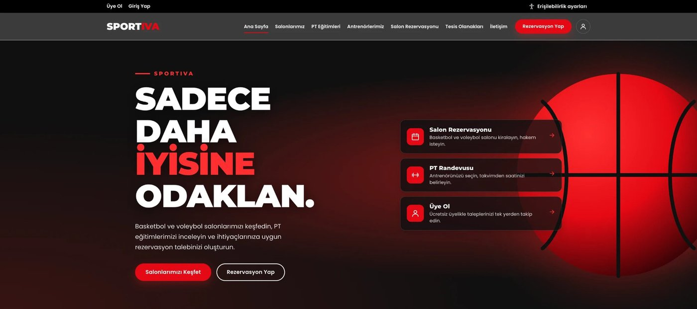
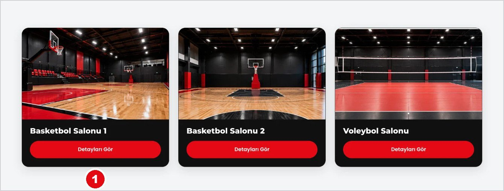
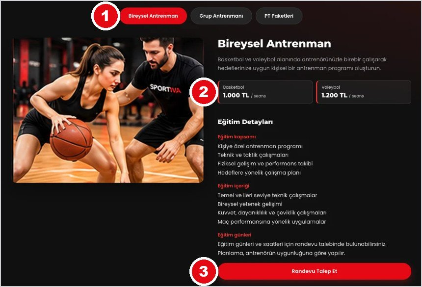
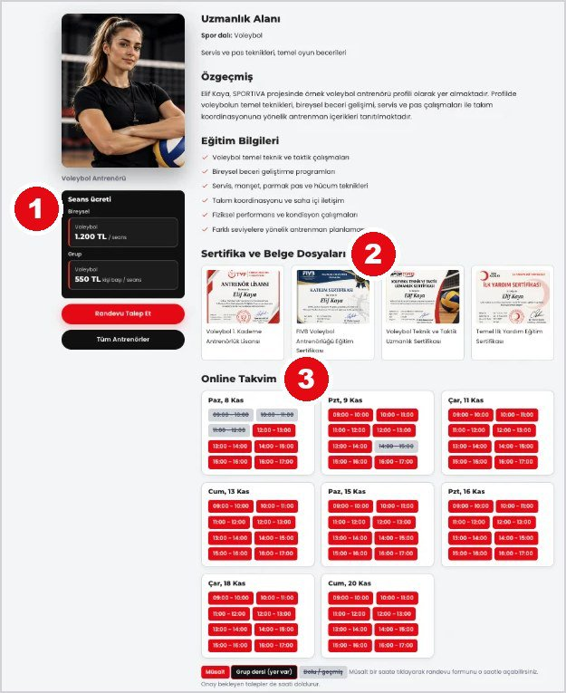
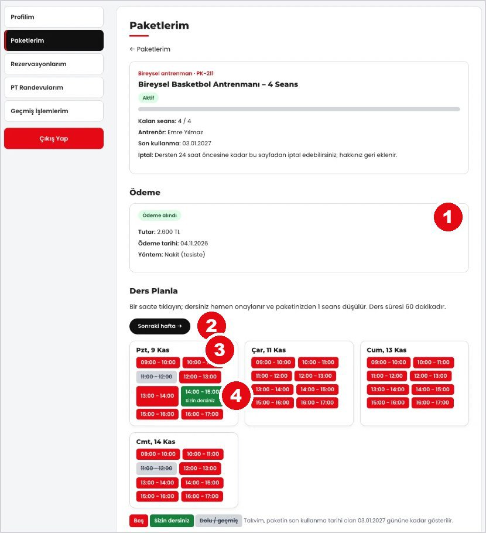
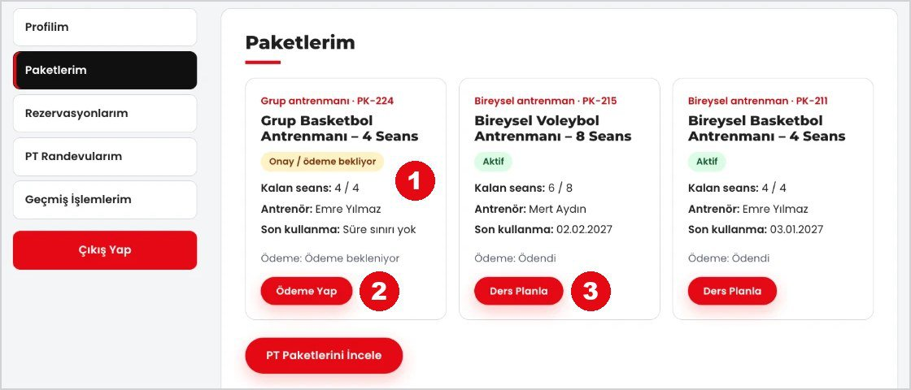
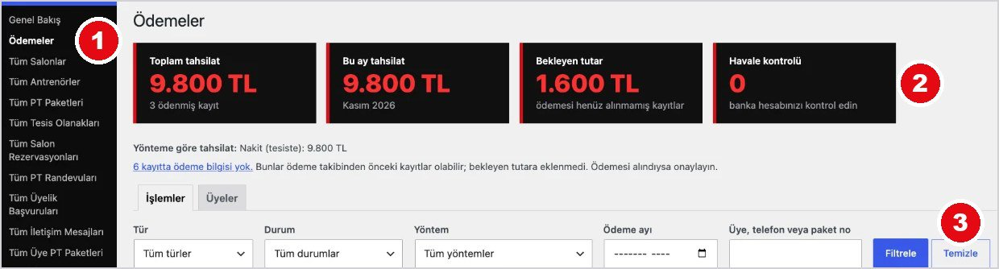
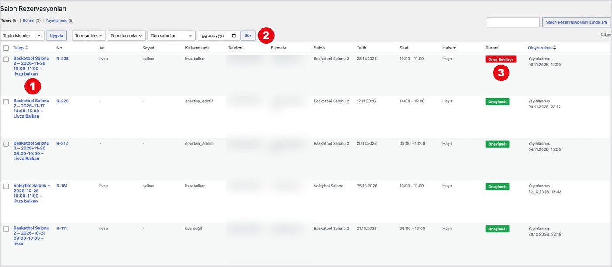

<h1 align="center">SPORTIVA</h1>

<p align="center">
  <b>Spor kompleksi için WordPress teması</b><br>
  Salon rezervasyonu · PT eğitimleri · Antrenör profilleri · Üyelik · Ödeme yönetimi
</p>

<p align="center">
  
  
  
  
</p>

<p align="center">
  
</p>

SPORTIVA, iki basketbol ve bir voleybol salonu olan bir spor kompleksinin web sitesi için geliştirilmiş özel bir WordPress temasıdır. Ziyaretçiler salonları ve antrenörleri inceleyebilir; üyeler salon kiralayabilir, PT paketi alıp derslerini takvimden planlayabilir. Yöneticiler ise bütün talepleri ve ödemeleri WordPress panelinden yönetir.

## İçindekiler
- [Özellikler](#özellikler)
- [Ekran görüntüleri](#ekran-görüntüleri)
- [Kurulum](#kurulum)
- [Klasör yapısı](#klasör-yapısı)
- [Kullanım kılavuzu](#kullanım-kılavuzu)

## Özellikler

### Ziyaretçi ve üye tarafı
| Modül | Ne yapar |
|---|---|
| **Salonlar** | 2 basketbol ve 1 voleybol salonu; fotoğraf galerisi, kapasite, ölçüler, çalışma saatleri, saatlik ücret |
| **Salon rezervasyonu** | Tarih ve saat seçimi, otomatik çakışma kontrolü, hakem hizmeti talebi, ücretin süreye göre hesaplanması |
| **PT eğitimleri** | Bireysel ve grup antrenmanı; branşa göre seans ücreti, eğitim kapsamı, içeriği ve günleri |
| **PT paketleri** | Paket satın alma, tesiste veya havale / EFT ile ödeme, haftalık takvimden ders planlama, 24 saat öncesine kadar iptal |
| **Antrenörler** | Uzmanlık alanı, özgeçmiş, sertifika ve belge dosyaları, online müsaitlik takvimi |
| **Tesis olanakları** | Kadın ve erkek soyunma odaları, otopark, kafe |
| **Üyelik** | Üye ol, giriş, şifre sıfırlama; üye panelinde profil, paketler, rezervasyonlar, randevular ve geçmiş işlemler |
| **Erişilebilirlik** | Yazı boyutu, yüksek kontrast, bağlantıların altını çizme ve hareketleri durdurma seçenekleri |

### Yönetici paneli
- Rezervasyon ve PT randevularını **onaylama, reddetme, iptal etme**; onaylanan saatte çakışma engellenir
- **Ödemeler ekranı:** toplam ve aylık tahsilat, bekleyen tutar, filtreler, tek seferde tam ödeme onayı, üye bazında toplamlar
- Üye listesi; salon, antrenör ve PT paketi yönetimi
- **Görünüm > Özelleştir** üzerinden metinler, seans ücretleri, iletişim ve ödeme bilgileri
- Tek tıkla yüklenip kaldırılabilen örnek içerik aracı
- Durum değişikliklerinde üyeye e-posta bildirimi

## Ekran görüntüleri

<table>
  <tr>
    <td width="50%"><br><sub><b>Salonlarımız</b></sub></td>
    <td width="50%"><br><sub><b>PT eğitimleri ve seans ücretleri</b></sub></td>
  </tr>
  <tr>
    <td><br><sub><b>Antrenör profili ve online takvim</b></sub></td>
    <td><br><sub><b>Paket ödemesi ve haftalık ders planlama</b></sub></td>
  </tr>
  <tr>
    <td><br><sub><b>Üye paneli: Paketlerim</b></sub></td>
    <td><br><sub><b>Yönetici: Ödemeler ekranı</b></sub></td>
  </tr>
</table>

<p align="center">
  <br>
  <sub><b>Yönetici: Salon rezervasyonları</b></sub>
</p>

## Kurulum

1. [Releases](../../releases) sayfasından `sportiva-v3.3.4.zip` dosyasını indirin.
   Alternatif olarak bu depodaki `sportiva` klasörünü zip'leyebilirsiniz.
2. WordPress yönetim panelinde **Görünüm > Temalar > Yeni Ekle > Tema Yükle** bölümünü açın, zip dosyasını yükleyip etkinleştirin.
   Sayfalar, menüler, 3 salon ve 4 tesis olanağı otomatik olarak oluşturulur.
3. **Ayarlar > Kalıcı Bağlantılar** ekranında "Yazı adı" seçeneğini kaydedin.
4. **Tüm Salonlar** ekranında her salonun **Saatlik ücret** alanını doldurun.
5. İsteğe bağlı: **SPORTIVA > Örnek İçerik** ekranından örnek antrenör ve paketleri yükleyin.

> E-posta bildirimleri için sunucuda e-posta (SMTP) ayarı gerekir. Yerel kurulumda (XAMPP) e-postalar gönderilmez; talepler yine kaydedilir.

## Klasör yapısı

```
sportiva/
├── style.css, functions.php     Tema tanımı ve yüklemeler
├── front-page.php, page-*.php   Sayfa şablonları
├── single-*.php                 Salon, antrenör ve tesis detay sayfaları
├── inc/                         İş mantığı: rezervasyon, paketler, ödemeler, üyelik, yönetim ekranları
├── template-parts/              Kartlar, formlar, üye paneli bölümleri
└── assets/                      CSS, JavaScript ve görseller
docs/
├── SPORTIVA_Site_Kullanim_Kilavuzu.pdf
└── screenshots/
```

## Kullanım kılavuzu

Üye ve yönetici işlemlerini adım adım anlatan kılavuz: **[SPORTIVA_Site_Kullanim_Kilavuzu.pdf](docs/SPORTIVA_Site_Kullanim_Kilavuzu.pdf)**

## Gereksinimler
- WordPress 5.8 veya üzeri
- PHP 7.4 veya üzeri

---

<p align="center"><sub>BMB 448 Düşük Kod Programlama dersi projesi · GPLv2 lisansı</sub></p>
